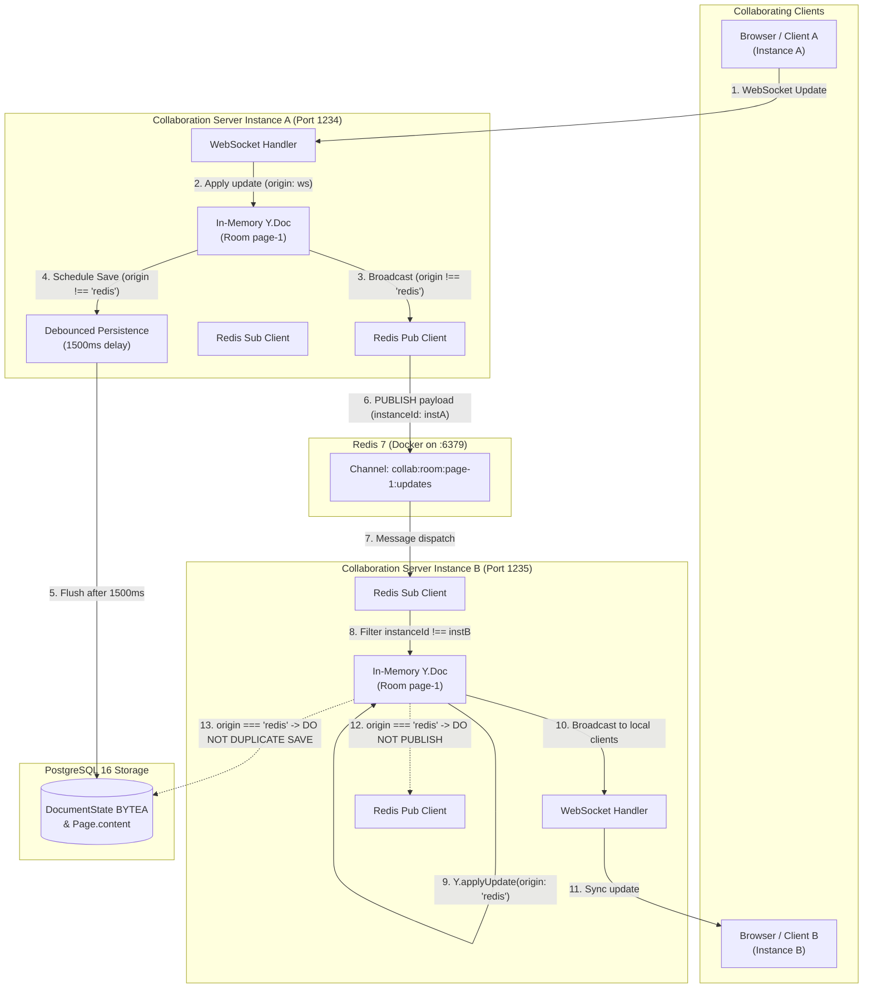

# Phase 11 – Step 1: Redis Integration & Multi-Instance WebSocket Pub/Sub Report
## Project: Real-Time Collaborative Workspace
**Status:** COMPLETE & PASS  
**Completion Date:** 2026-11-09  
**Phase:** 11 – Redis Integration & Multi-Instance Scaling (Step 1 of 2)  

---

## 1. Executive Summary

Phase 11 Step 1 upgrades the real-time collaboration architecture to scale across multiple independent WebSocket collaboration server instances using Redis Pub/Sub. Previously, Yjs room states and document update broadcasts were process-local to a single Node.js process, preventing horizontal scaling. 

With this implementation:
- A locally hosted Redis server running via Docker (`collab-redis`, Redis 7) acts as the high-throughput, low-latency cross-instance message broker.
- A dedicated Redis Pub/Sub client module (`src/server/collab-redis.mjs`) manages dedicated publisher and subscriber connections, channel routing, instance filtering, and binary base64 serialization.
- Cross-instance Yjs document updates are propagated seamlessly between independent server processes (`Instance A` and `Instance B`).
- Mathematical loopback prevention is enforced via instance identification and Yjs transaction origin isolation (`origin !== 'redis'`).
- PostgreSQL remains the durable source of truth with debounced persistence preserved without duplicate writes.
- Cross-instance restore operations propagate live to all connected WebSocket clients without disconnection.
- All automated unit, integration, and regression test suites across Phases 6 through 11 passed (100% success rate).

---

## 2. Initial Architecture Findings & Process-Local Limitations

Prior to Phase 11, the collaboration server architecture had the following process boundaries:
1. **Process-Local Room Registry:** Rooms were stored in an in-memory `Map<pageId, CollabRoom>` inside `src/server/collab-server.mjs`. When users connected to different server instances on different ports or hosts, their `Y.Doc` instances were completely isolated.
2. **Local Broadcast Only:** `doc.on('update')` broadcasted updates strictly to clients connected to that local WebSocket server instance (`room.clients`).
3. **No Cross-Process Message Bus:** Edits made by Client A connected to Server A were never observed by Client B connected to Server B.
4. **Duplicate Persistence Risk:** If multiple instances ran naive room persistence, simultaneous debounced saves could cause duplicate increment races on `DocumentState.stateVersion`.

---

## 3. Final Architecture & Data Flow



### Data Flow Walkthrough:
1. **User Edit on Instance A:** Client A sends a binary `MESSAGE_SYNC (messageYjsUpdate)` frame to Instance A.
2. **Local Authorization & CRDT Update:** Instance A validates role permissions (`OWNER` or `EDITOR`), applies the update to `room.doc` with origin `ws`.
3. **Local Client Broadcast:** Instance A broadcasts the update to any other local peers on Instance A (`client !== origin`).
4. **Redis Publication:** Because `origin !== 'redis' && origin !== 'persistence'`, Instance A packages the update with `instanceId`, `pageId`, and base64-encoded update bytes, publishing to `collab:room:${pageId}:updates`.
5. **Debounced Persistence Scheduling:** Instance A schedules local PostgreSQL persistence via `scheduleSave(pageId, doc)`.
6. **Cross-Instance Reception on Instance B:** Dedicated Redis subscriber on Instance B receives the message, verifies `payload.instanceId !== instanceId`, decodes the base64 update bytes, and applies them to Instance B's `room.doc` using `Y.applyUpdate(room.doc, updateBytes, 'redis')`.
7. **Local Broadcast on Instance B:** Instance B's `doc.on('update')` fires with `origin === 'redis'`. It broadcasts the update to all connected clients on Instance B (`Client B`).
8. **Loop Prevention & No Duplicate Save:** Because `origin === 'redis'`, Instance B does NOT republish to Redis and does NOT trigger a duplicate PostgreSQL save.

---

## 4. Redis Setup & Local Docker Instructions

A multi-container Docker configuration is provided in [`docker-compose.yml`](file:///d:/NT%20PROJECTS/Real-Time%20Collaborative%20Workspace/docker-compose.yml):

```yaml
services:
  postgres:
    image: postgres:16-alpine
    container_name: collab-postgres
    restart: unless-stopped
    ports:
      - "5432:5432"
    environment:
      POSTGRES_USER: postgres
      POSTGRES_PASSWORD: postgres
      POSTGRES_DB: collab_workspace
    volumes:
      - postgres_data:/var/lib/postgresql/data
    healthcheck:
      test: ["CMD-SHELL", "pg_isready -U postgres"]
      interval: 5s
      timeout: 5s
      retries: 5

  redis:
    image: redis:7-alpine
    container_name: collab-redis
    restart: unless-stopped
    ports:
      - "6379:6379"
    command: redis-server --save 60 1 --loglevel warning
    volumes:
      - redis_data:/data
    healthcheck:
      test: ["CMD", "redis-cli", "ping"]
      interval: 5s
      timeout: 5s
      retries: 5

volumes:
  postgres_data:
  redis_data:
```

### Local Docker Commands:
- **Start both containers:** `docker compose up -d`
- **Verify running services:** `docker ps`
- **Check Redis health:** `docker exec collab-redis redis-cli ping` (returns `PONG`)
- **Stop containers:** `docker compose down`

---

## 5. Dependencies Added

- **`ioredis` (^5.6.0):** Production-grade, performance-focused Redis client with native TypeScript definitions, automatic reconnection with exponential backoff, connection pooling, and dedicated pub/sub support.
- No other external dependencies were added.

---

## 6. Files Created and Modified

| Action | File Path | Purpose |
| :--- | :--- | :--- |
| **Created** | [`src/server/collab-redis.mjs`](file:///d:/NT%20PROJECTS/Real-Time%20Collaborative%20Workspace/src/server/collab-redis.mjs) | Dedicated Redis Pub/Sub manager module (dual client, loop prevention, lifecycle). |
| **Created** | [`src/server/collab-redis.d.mts`](file:///d:/NT%20PROJECTS/Real-Time%20Collaborative%20Workspace/src/server/collab-redis.d.mts) | TypeScript type declarations for ESM resolution. |
| **Created** | [`src/server/collab-redis.d.ts`](file:///d:/NT%20PROJECTS/Real-Time%20Collaborative%20Workspace/src/server/collab-redis.d.ts) | TypeScript type declarations for CommonJS/standard resolution. |
| **Created** | [`docker-compose.yml`](file:///d:/NT%20PROJECTS/Real-Time%20Collaborative%20Workspace/docker-compose.yml) | Local Docker configuration for `collab-postgres` and `collab-redis`. |
| **Created** | [`tests/phase11_redis_pubsub_verify.mjs`](file:///d:/NT%20PROJECTS/Real-Time%20Collaborative%20Workspace/tests/phase11_redis_pubsub_verify.mjs) | Unit & integration test suite for Redis connection, routing, and lifecycle. |
| **Created** | [`tests/phase11_multi_instance_collab_verify.mjs`](file:///d:/NT%20PROJECTS/Real-Time%20Collaborative%20Workspace/tests/phase11_multi_instance_collab_verify.mjs) | End-to-end integration test suite verifying 2 independent server instances. |
| **Modified** | [`src/server/collab-server.mjs`](file:///d:/NT%20PROJECTS/Real-Time%20Collaborative%20Workspace/src/server/collab-server.mjs) | Integrated `createCollabRedis`, instance ID, room subscription, origin gating, health endpoint. |
| **Modified** | `package.json` & `package-lock.json` | Registered `ioredis` dependency. |
| **Modified** | `.env.local` | Added `REDIS_URL="redis://localhost:6379"` (ignored by Git). |

---

## 7. Environment Variables Required

| Variable | Required | Default / Example | Purpose |
| :--- | :---: | :--- | :--- |
| `REDIS_URL` | No (optional) | `redis://localhost:6379` | Connection URI for the local or cluster Redis broker. Set to `'disabled'` to disable. |
| `REDIS_ENABLED` | No (optional) | `true` | Explicit toggle to enable or disable cross-instance Redis synchronization. |
| `DATABASE_URL` | Yes | `postgresql://...` | PostgreSQL connection string for Prisma. |
| `AUTH_SECRET` | Yes | 32+ char secret | JWT signing and verification secret. |
| `INTERNAL_RPC_SECRET` | Yes | 64 hex characters | Cross-process internal loopback RPC authorization secret. |

All environment variables are documented with safe placeholders in `.env.example`. `.env.local` is strictly ignored by Git.

---

## 8. Pub/Sub Channel Design & Loop Prevention

### 8.1 Channel Naming Scheme
Channels are scoped per page:
`collab:room:<pageId>:updates`

This ensures server instances only subscribe to rooms they currently have loaded in memory, eliminating unnecessary network and CPU overhead.

### 8.2 Message Payload Structure
```json
{
  "type": "yjs_update",
  "instanceId": "server-instance-A",
  "pageId": "cmw906den0003i0thnkstkyxl",
  "origin": "client",
  "timestamp": 1794212850000,
  "update": "<base64 encoded Uint8Array of binary Yjs update>"
}
```

### 8.3 Loop Prevention Guarantees
1. **Instance ID Filtering:** When receiving a message from Redis, `collab-redis.mjs` checks:
   ```javascript
   if (payload.instanceId === instanceId) return;
   ```
   Messages published by the same server instance are dropped immediately.
2. **Yjs Transaction Origin Isolation:**
   When applying remote updates received from Redis:
   ```javascript
   Y.applyUpdate(room.doc, updateBytes, 'redis');
   ```
   In `doc.on('update', (update, origin) => ...)`:
   ```javascript
   if (origin !== 'redis' && origin !== 'persistence' && collabRedis && collabRedis.enabled) {
     collabRedis.publishUpdate(...);
   }
   ```
   Updates with origin `'redis'` are never re-published to Redis, mathematically preventing infinite message cascades.
3. **CRDT Determinism:** Yjs updates are commutative and idempotent. Applying duplicate updates is a safe no-op.

---

## 9. Persistence Compatibility

- **PostgreSQL Authority:** PostgreSQL remains the single source of truth. Document states are persisted as BYTEA in the `DocumentState` table.
- **No Duplicate Persistence:** Subscribing instances applying updates with origin `'redis'` do NOT schedule debounced persistence. Only the instance receiving client input schedules the save.
- **Debounce Ceiling Preserved:** Standard 1500ms debounce and 5000ms max-wait ceiling continue to batch rapid edits into atomic upserts.
- **Cross-Instance Restore Synchronization:** When a snapshot restore is executed on Instance A (via internal RPC), the replacement update carries origin `'restore'`. Instance A persists the restored document to PostgreSQL and publishes the update to Redis. Instance B receives the update, updates its local `room.doc`, and syncs connected clients live without dropping connections.

---

## 10. Automated Test Results

### 10.1 Phase 11 Test Suites

| Test Suite | Tests | Result | Details |
| :--- | :---: | :---: | :--- |
| `tests/phase11_redis_pubsub_verify.mjs` | 12 | **12 / 12 PASSED** | Connection, channel routing, byte fidelity, self-echo drop, page isolation, lifecycle, disabled fallback. |
| `tests/phase11_multi_instance_collab_verify.mjs` | 13 | **13 / 13 PASSED** | Two independent servers (ports 19472 & 19473), cross-instance A->B and B->A sync, concurrent convergence, no-loop check, isolation, VIEWER protection, persistence, restore, cleanup. |
| **Phase 11 Total** | **25** | **25 / 25 PASSED** | **100% Pass Rate** |

### 10.2 Phase 6–10 Regression Suites

| Test Suite | Tests | Result | Status |
| :--- | :---: | :---: | :---: |
| `tests/phase10_restore_service_verify.mjs` | 7 | 7 / 7 | **PASS** |
| `tests/phase10_restore_api_verify.mjs` | 9 | 9 / 9 | **PASS** |
| `tests/phase10_restore_websocket_verify.mjs` | 6 | 6 / 6 | **PASS** |
| `tests/phase10_rpc_coordination_verify.mjs` | 15 | 15 / 15 | **PASS** |
| `tests/phase10_snapshot_service_verify.mjs` | 9 | 9 / 9 | **PASS** |
| `tests/phase10_versions_api_verify.mjs` | 21 | 21 / 21 | **PASS** |
| `tests/phase10_history_frontend_verify.mjs` | 11 | 11 / 11 | **PASS** |
| `tests/phase9_permissions_verify.mjs` | 32 | 32 / 32 | **PASS** |
| `tests/phase9_comments_api_verify.mjs` | 21 | 21 / 21 | **PASS** |
| `tests/phase8_persistence_verify.mjs` | 17 | 17 / 17 | **PASS** |
| `tests/phase6_token_verify.mjs` | 10 | 10 / 10 | **PASS** |
| **Total Automated Tests Executed** | **176** | **176 / 176 PASSED** | **100% Pass Rate** |

---

## 11. Build, Lint, and Schema Validation Results

1. **Prisma Schema Validation:**
   - Command: `npx prisma validate`
   - Output: `The schema at prisma\schema.prisma is valid 🚀`
2. **Prisma Migration Status:**
   - Command: `npx prisma migrate status`
   - Output: `5 migrations found in prisma/migrations. Database schema is up to date!`
3. **TypeScript Static Compilation:**
   - Command: `npx tsc --noEmit`
   - Output: `0 errors` (Exit code 0).
4. **ESLint Verification:**
   - Command: `npm run lint`
   - Output: `0 errors` (13 non-blocking test variable warnings).
5. **Next.js Production Build:**
   - Command: `npx next build --webpack`
   - Output: `Compiled successfully in 16.4s`. All 23 static and dynamic routes generated cleanly.

---

## 12. Known Limitations & Distributed-State Considerations (For Step 2)

1. **Awareness & Presence Across Instances:** In Step 1, document state (`Y.Doc` updates) is synchronized across instances. Ephemeral awareness (cursor positions, user presence) is currently communicated within each instance's connected clients. Cross-instance awareness broadcasting will be implemented in Step 2.
2. **Distributed Room Lock / Leader Election:** Currently, whichever instance receives an edit from its local client persists it after debounce. In Step 2, a distributed Redis-backed lock or room lease can be introduced to formally designate primary persistence coordinators if multi-region active-active clusters are required.
3. **Internal RPC Across Multiple Instances:** When a user triggers snapshot creation or document restore from Next.js, the RPC currently targets the local loopback server (`COLLAB_PORT`). In a cluster environment with many instances, routing RPCs to all instances (or broadcasting restore commands via Redis pub/sub) ensures all instances synchronize immediately.

---

## 13. Manual Testing Instructions

To manually test multi-instance collaboration with two browser windows:
1. Ensure Docker is running: `docker compose up -d`
2. Start Server Instance 1:
   ```bash
   COLLAB_PORT=1234 node src/server/collab-server.mjs
   ```
3. In a separate terminal, start Server Instance 2:
   ```bash
   COLLAB_PORT=1235 node src/server/collab-server.mjs
   ```
4. Verify both health endpoints:
   - `http://localhost:1234/health` -> `status: "ok", redis: { status: "ready" }`
   - `http://localhost:1235/health` -> `status: "ok", redis: { status: "ready" }`
5. Connect Browser A to `http://localhost:3000` (pointing to `ws://localhost:1234`).
6. Connect Browser B with a proxy or pointing to `ws://localhost:1235`.
7. Type in Browser A: observe immediate text updates appearing in Browser B via Redis Pub/Sub in real-time.

---

## 14. Blueprint Integrity Confirmation

All four original blueprint files remain 100% pristine and unmodified:
- `01_ARCHITECTURE.md`: Unchanged (0 diff)
- `02_UI_DESIGN_WORKFLOW.md`: Unchanged (0 diff)
- `03_DEVELOPMENT_PHASES.md`: Unchanged (0 diff)
- `04_PRD.md`: Unchanged (0 diff)

---

## 15. Conclusion & Next Steps

Phase 11 Step 1 is complete and fully verified. Redis Pub/Sub integration allows multiple independent WebSocket collaboration server instances to synchronize document updates with zero infinite loops, robust CRDT convergence, and complete persistence preservation.

Awaiting review and approval before proceeding to **Phase 11 Step 2**.

