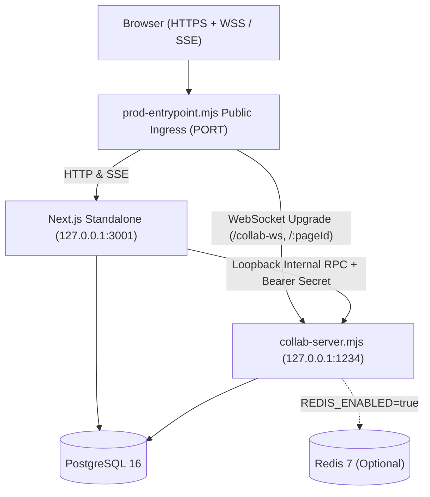

# Real-Time Collaborative Workspace

A Notion-style real-time collaborative document workspace powered by **Next.js 16**, **React 19**, **TipTap 3**, **Yjs CRDT**, **PostgreSQL 16 (Prisma 7)**, and optional **Redis 7**, designed to run locally or deploy cleanly on a strict **₹0 budget**.

---

## Features

- **Authentication & Sessions**: Email/password signup and login (`bcryptjs`), HS256 JWT stored in HTTP-only `collab_session` cookie (`jose`), and App Router `middleware.ts` protection for `/dashboard` and `/workspace/*`.
- **Workspaces & Role-Based Permissions (RBAC)**: Multi-workspace management with four roles (`OWNER`, `EDITOR`, `COMMENTER`, `VIEWER`), member invitations by email, role updates, and server-side IDOR enforcement on every endpoint.
- **Hierarchical Document Pages & Live Tree Sync**: Nested pages (`parentPageId` hierarchy with circular-parent prevention) synchronized across workspace members via authenticated Server-Sent Events (`/api/workspaces/[workspaceId]/pages/events`).
- **Real-Time Collaborative Editing (Yjs + TipTap)**: Dedicated `ws` collaboration server (`src/server/collab-server.mjs`) running `y-websocket` protocol with first-message JWT authentication (no JWTs in query strings) and read-only enforcement for `COMMENTER` / `VIEWER`.
- **Live Presence & Cursors**: Multi-user collaborator avatars and live cursor carets (`@tiptap/extension-collaboration-caret`) with server-side awareness identity sanitization (`sanitizeAwarenessUpdate`) preventing user spoofing.
- **PostgreSQL CRDT Persistence**: Binary Yjs snapshots (`DocumentState.yjsState`) stored with monotonically incrementing `stateVersion`, debounced writes (`1500ms` delay / `5000ms` max wait), per-document sequential write queues, legacy `Page.content` JSONB fallback hydration, and save-status notifications (`saving` / `saved` / `error`).
- **Comments & Resolution Workflow**: Anchored inline/page comments restricted to `OWNER`, `EDITOR`, and `COMMENTER`, with resolve/unresolve, edit, and delete permissions scoped to authors and workspace owners.
- **Version History & Live Restore**: Paginated manual and automatic snapshots (`VersionSnapshot`) with TipTap JSON preview, safety auto-snapshots created prior to restores, loopback internal RPC synchronization to update live `Y.Doc` rooms in real time, and DB fallback when no room is active.
- **Optional Redis Scaling**: Toggleable via `REDIS_ENABLED` (`src/server/collab-redis.mjs`) for cross-instance Pub/Sub updates, awareness fan-out, and distributed persistence/restore locks (safe single-instance mode when `REDIS_ENABLED=false`).
- **Production Security & Supervision**: Same-origin CSRF guards, bounded request payloads (`413`), sliding-window rate limiting (`429`), CSP + security headers, startup environment validation (`src/lib/env.mjs`), and single-container production supervisor (`scripts/prod-entrypoint.mjs`).

---

## Technology Stack

| Layer | Technology |
| --- | --- |
| Frontend & API | Next.js `16.4.3` (App Router, `output: "standalone"`), React `19.3.0`, TypeScript, Tailwind CSS v4, `lucide-react` |
| Rich Text & CRDT | TipTap `^3.32.2`, `yjs` `^13.6.33`, `y-websocket` `^3.1.0`, `y-protocols`, `lib0` |
| WebSocket Server | Dedicated Node.js 22 server (`ws ^8.22.1`, `src/server/collab-server.mjs`) |
| Database & ORM | PostgreSQL 16, Prisma `7.10.1` (`@prisma/adapter-pg`, `pg ^8.13.3`) |
| Real-Time Scaling (Optional) | Redis 7, `ioredis ^6.0.0` |
| Auth & Validation | `jose ^6.2.14`, `bcryptjs ^3.0.3`, `zod ^4.6.7` |
| Packaging & Deployment | Multi-stage `Dockerfile` (`node:22-alpine`, non-root user), `docker-compose.yml`, `docker-compose.prod.yml`, `render.yaml` |

---

## Architecture Overview

In production (`Dockerfile` / `render.yaml` / `docker-compose.prod.yml`), [`scripts/prod-entrypoint.mjs`](file:///d:/NT%20PROJECTS/Real-Time%20Collaborative%20Workspace/scripts/prod-entrypoint.mjs) supervises both Node processes in one container so loopback RPCs (`/internal/rooms/:pageId/*`) and in-memory SSE streams work seamlessly while exposing a single multiplexed HTTP + WebSocket port (`PORT`):



Detailed diagrams and component flows live in [docs/ARCHITECTURE.md](file:///d:/NT%20PROJECTS/Real-Time%20Collaborative%20Workspace/docs/ARCHITECTURE.md).

---

## Repository Structure

```text
├── src/
│   ├── app/
│   │   ├── api/                  # REST & SSE API route handlers (auth, workspaces, members, pages, comments, versions, health)
│   │   ├── dashboard/            # Authenticated workspace list dashboard
│   │   ├── workspace/[workspaceId]/ # Main collaborative workspace editor UI
│   │   ├── login/ & signup/      # Authentication pages
│   │   ├── layout.tsx, page.tsx  # Root layout & landing page
│   ├── components/               # UI components (editor, sidebar, sharing, comments, history, layout, primitives)
│   ├── lib/
│   │   ├── auth/                 # Session JWT, collab JWT, password hashing, RBAC checkWorkspaceAccess
│   │   ├── collab/               # Client AuthenticatedWebSocket transport & WebsocketProvider factory
│   │   ├── events/               # In-memory workspace SSE emitter
│   │   ├── security/             # Same-origin CSRF, rate limiting, bounded JSON reader, HTTP headers
│   │   ├── validations/          # Zod schemas
│   │   ├── env.mjs               # Centralized runtime env & secret validation + URL credential redaction
│   │   └── prisma.ts             # Shared Prisma 7 PG adapter pool singleton
│   ├── server/
│   │   ├── collab-server.mjs     # Dedicated Yjs WS server + /healthz + loopback /internal/* RPCs
│   │   ├── collab-persistence.mjs# Debounced BYTEA Y.Doc saves, queues, legacy fallback, awareness sanitizer
│   │   ├── collab-redis.mjs      # Optional Redis pub/sub & Lua-safe distributed locks
│   │   ├── collab-internal-client.mjs # Loopback RPC client from Next.js API -> collab-server
│   │   └── version-snapshot-service.mjs # Snapshot creation, WordCount/JSON extraction, safe transactional restore
│   ├── instrumentation.ts        # Startup env validation hook for Next.js Node runtime
│   └── middleware.ts             # Route protection (/dashboard, /workspace)
├── prisma/
│   ├── schema.prisma             # Database models & Phase 12 indexes
│   └── migrations/               # Committed SQL migrations (0_init -> phase12_indexes_and_safety)
├── scripts/
│   ├── prod-entrypoint.mjs       # Multi-process production supervisor & HTTP/WS ingress proxy
│   ├── validate_env.mjs          # CLI preflight validator (npm run env:check)
│   ├── verify_env_secrets.mjs    # Automated secrets & env validation tests
│   └── verify_prod_runtime.mjs   # Production server, healthcheck, RPC & WS security verification suite
├── docs/
│   ├── ARCHITECTURE.md           # System, data, auth, Yjs & restore architecture
│   ├── API.md                    # Complete HTTP/SSE, internal RPC, and WebSocket protocol spec
│   ├── ENVIRONMENT.md            # Every environment variable, default & strict prod validation rules
│   └── DEPLOYMENT.md             # Local Dev, Production Docker Compose, and Render Free + Neon Free runbooks
├── Dockerfile                    # Multi-stage non-root Node 22 production build
├── docker-compose.yml            # Local Postgres 16 + Redis 7 services
├── docker-compose.prod.yml       # Production stack (postgres + redis + supervised app container)
├── render.yaml                   # Render Free Docker blueprint (single-instance, REDIS_ENABLED=false)
└── .env.example                  # Placeholder-only environment template
```

---

## Documentation Guides

- **[Environment Configuration (`docs/ENVIRONMENT.md`)](file:///d:/NT%20PROJECTS/Real-Time%20Collaborative%20Workspace/docs/ENVIRONMENT.md)** — Required vs. optional variables, public vs. server-only scoping, strict format rules, and secret generation.
- **[Architecture Deep Dive (`docs/ARCHITECTURE.md`)](file:///d:/NT%20PROJECTS/Real-Time%20Collaborative%20Workspace/docs/ARCHITECTURE.md)** — ER diagram, RBAC permission matrix, Yjs auth/sync/persistence, version restore fan-out, and Redis behavior.
- **[API & WebSocket Spec (`docs/API.md`)](file:///d:/NT%20PROJECTS/Real-Time%20Collaborative%20Workspace/docs/API.md)** — All App Router HTTP/SSE endpoints, rate limits, internal loopback RPCs, and WebSocket binary/JSON protocol frames.
- **[Deployment Runbooks (`docs/DEPLOYMENT.md`)](file:///d:/NT%20PROJECTS/Real-Time%20Collaborative%20Workspace/docs/DEPLOYMENT.md)** — Step-by-step Local Dev, Production Docker Compose, and Render Free + Neon Free (₹0) instructions.

---

## Quick Start (Local Development)

1. **Prerequisites**: Node.js 22.x (`node -v`) and Docker Desktop (or PostgreSQL 16 + Redis 7).
2. **Install & start local Postgres/Redis**:
   ```bash
   npm ci
   docker compose up -d
   ```
3. **Create `.env.local` from `.env.example`** with strong random `AUTH_SECRET` (>= 32 chars) and `INTERNAL_RPC_SECRET` (64 hex chars), plus your local `DATABASE_URL` (also visible to Prisma CLI via `.env` or shell env):
   ```bash
   npm run env:check
   npx prisma generate
   npx prisma migrate deploy
   ```
4. **Start Next.js & Collaboration Server** (two terminals):
   ```bash
   npm run dev
   npm run collab
   ```
5. Open `http://localhost:3000`. See [docs/DEPLOYMENT.md](file:///d:/NT%20PROJECTS/Real-Time%20Collaborative%20Workspace/docs/DEPLOYMENT.md) for production Docker Compose (`docker-compose.prod.yml`) and Render Free + Neon Free deployment.

---

## Testing & Verification Scripts

```bash
# TypeScript typecheck & ESLint & Next.js production build
npx tsc --noEmit
npm run lint
npm run build

# Environment & secrets preflight + security unit tests
npm run env:check -- --strict
node scripts/verify_env_secrets.mjs

# Production entrypoint, WebSocket first-message JWT auth, RPC isolation & Docker checks
node scripts/verify_prod_runtime.mjs

# RBAC & multi-user feature regression scripts (requires running local DB/servers; inspect script headers before executing)
node scripts/run_phase9_perm.mjs
node scripts/run_global_regression.mjs
```

---

## Known Limitations

- **Single-Instance SSE Tree Stream**: Page create/rename/delete SSE events (`/pages/events`) use an in-memory `EventEmitter` (`src/lib/events/workspace-events.ts`), so SSE works across clients connected to the same Next.js instance without Redis SSE bridging.
- **In-Memory Rate Limiter**: HTTP route rate limiting (`src/lib/security/api-guard.ts`) stores sliding-window counters per Node.js process rather than in Redis.
- **₹0 Cloud Tier Constraints**: Deploying on Render Free (`render.yaml`, `REDIS_ENABLED=false`) caps scaling to a single container instance and incurs ~30–60s cold starts after ~15 minutes of inactivity. No Redis server is provisioned on the ₹0 Render blueprint; enable Redis via `docker-compose.prod.yml` or an external Redis service if scaling horizontally.
- **Database Migrations in Production Container**: The minimal runtime `Dockerfile` intentionally excludes Prisma CLI dev packages to keep image size small; run `npx prisma migrate deploy` from your workstation or CI/CD before starting or upgrading a production deployment.
