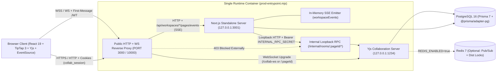
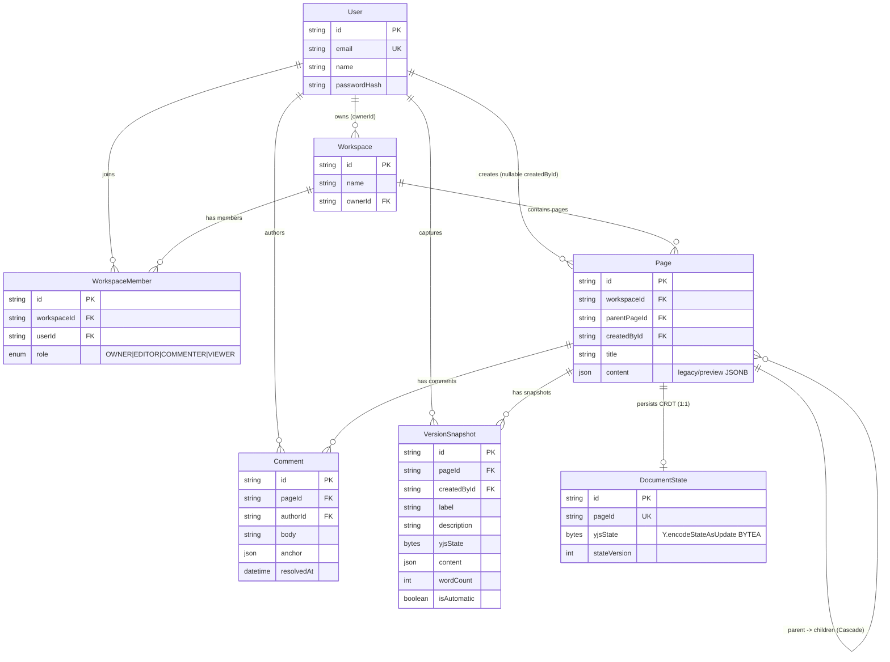
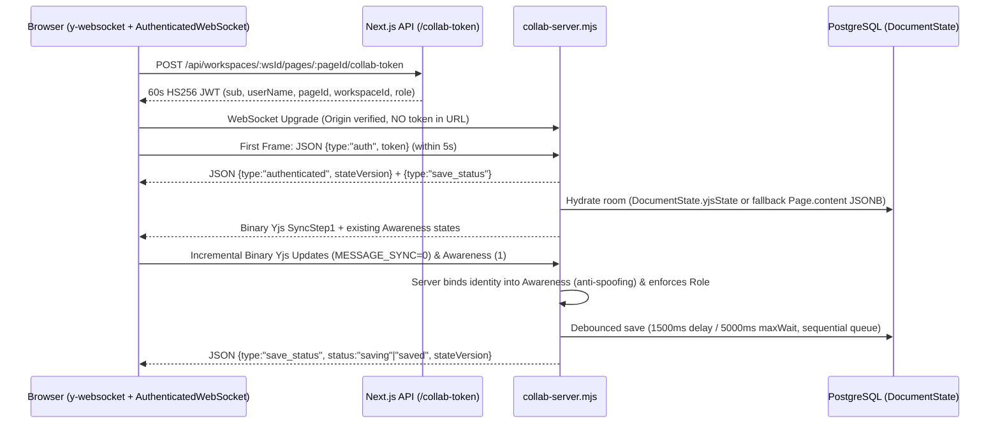
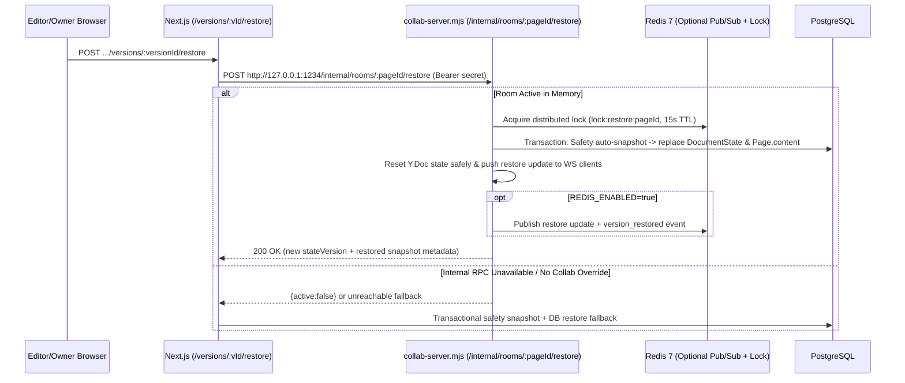

# System Architecture

**Real-Time Collaborative Workspace** is a full-stack Notion-style collaborative document workspace built on **Next.js 16.4.3 (App Router, standalone output)**, **PostgreSQL 16 + Prisma ORM 7 (`@prisma/adapter-pg`)**, **TipTap 3 / ProseMirror**, **Yjs CRDT (`y-websocket`)**, and optional **Redis 7** pub/sub + distributed locks.

To satisfy a strict **₹0 production deployment constraint** while preserving internal loopback RPCs, WebSocket real-time sync, and in-memory Server-Sent Events (SSE), Next.js and the dedicated Yjs collaboration server run inside a single container supervised by [`scripts/prod-entrypoint.mjs`](file:///d:/NT%20PROJECTS/Real-Time%20Collaborative%20Workspace/scripts/prod-entrypoint.mjs).

---

## 1. High-Level System Overview

---

## 2. Production Single-Container Supervision (`scripts/prod-entrypoint.mjs`)

Splitting Next.js and `src/server/collab-server.mjs` across separate hosts breaks two design assumptions in the codebase:
1. Next.js triggers document flush and version restore via **loopback-only** HTTP RPCs on `127.0.0.1:${COLLAB_PORT}` (`src/server/collab-internal-client.mjs`).
2. Page hierarchy updates stream over SSE (`GET /api/workspaces/[workspaceId]/pages/events`) backed by an in-memory Node `EventEmitter` singleton (`src/lib/events/workspace-events.ts`).

`scripts/prod-entrypoint.mjs` solves this cleanly within one process tree:
1. **Startup Order**: Boots `collab-server.mjs` (`127.0.0.1:COLLAB_PORT`, default `1234`) first and polls `/healthz` until DB & Redis (if enabled) pass; then boots Next.js standalone (`server.js` on `127.0.0.1:NEXT_INTERNAL_PORT`, default `3001`) and polls `/api/health`.
2. **Multiplexed Public Ingress (`PORT`)**:
   - Explicitly rejects external requests to `/internal` or `/internal/*` with `403 Forbidden`.
   - Proxies `/collab-ws` / `/collab-ws/*` HTTP `GET` checks if needed or upgrades any WebSocket request (`upgrade` header) when path starts with `/collab-ws`, `/room/`, `/rooms/`, or targets `collab-server.mjs` when host matches non-Next traffic.
   - Proxies all remaining HTTP traffic and SSE streams (long-lived responses with socket timeouts disabled) to Next.js standalone on `127.0.0.1:3001`.
3. **Optional Dual-Port Ingress (`COLLAB_PUBLIC_PORT`)**: When `COLLAB_PUBLIC_PORT` is set (such as `1235` in `docker-compose.prod.yml` mapped from host `1234`), opens a second listener forwarding WS upgrades and `/health`/`/healthz` directly to `collab-server.mjs`.
4. **Coordinated Graceful Shutdown (`SIGTERM` / `SIGINT`)**:
   - Stops accepting new public connections (`503` on new health checks).
   - Terminates Next.js first, then sends `SIGTERM` to `collab-server.mjs` so active `Y.Doc` rooms flush unsaved updates to PostgreSQL before exiting.

---

## 3. Data Model (`prisma/schema.prisma`)

Database indexes added in `20261112143000_phase12_indexes_and_safety`:
- `Page(workspaceId, createdAt)` (`pages_workspaceId_createdAt_idx`)
- `Page(workspaceId, parentPageId, createdAt)` (`pages_workspaceId_parentPageId_createdAt_idx`)
- `Comment(pageId, createdAt)` (`comments_pageId_createdAt_idx`)

---

## 4. Authentication & Authorization (RBAC)

### Session & Middleware Flow
- **Password Hashing**: `bcryptjs` (`src/lib/auth/password.ts`) with per-user salts; signup enforces >= 8 char passwords (`<= 128`), max 100 chars name (`src/lib/auth/validation.ts`).
- **Session Cookie (`collab_session`)**: HS256 JWT minted with `jose` (`7d` expiration), stored as `httpOnly: true`, `sameSite: 'lax'`, `secure: NODE_ENV === 'production'`, `path: '/'` (`src/lib/auth/session.ts`).
- **Edge Route Guard (`src/middleware.ts`)**: Protects `/dashboard*` and `/workspace*` (redirects unauthenticated requests to `/login?callbackUrl=...`); redirects authenticated users away from `/login` and `/signup` to `/dashboard`.
- **Workspace Membership & IDOR Prevention**: Every API route calls `checkWorkspaceAccess(workspaceId)` (`src/lib/auth/workspace-auth.ts`) and verifies resource ownership (`page.workspaceId === workspaceId`, `comment.pageId === pageId`).

### Role Matrix

| Capability | `OWNER` | `EDITOR` | `COMMENTER` | `VIEWER` |
| --- | :---: | :---: | :---: | :---: |
| Read workspace, pages, comments, version history | Yes | Yes | Yes | Yes |
| WebSocket collaboration connect & live cursor presence | Yes | Yes | Yes (read-only sync) | Yes (read-only sync) |
| Edit document content (`Yjs Update` / `SyncStep2`) | Yes | Yes | Rejected (`permission_denied`) | Rejected (`permission_denied`) |
| Create/rename/delete pages | Yes | Yes | 403 | 403 |
| Create comments; resolve/edit/delete own comments | Yes | Yes | Yes | 403 |
| Resolve/edit/delete any member's comment | Yes | 403 (own only) | 403 (own only) | 403 |
| Create manual version snapshot & restore version | Yes | Yes | 403 | 403 |
| Manage members, change roles, rename/delete workspace | Yes | 403 | 403 | 403 |

---

## 5. Real-Time Collaboration, Persistence & Version Restore Flows

### Authenticated WebSocket & Yjs Lifecycle

### Live Presence & Cursors
- TipTap `@tiptap/extension-collaboration-caret` / Yjs Awareness propagates cursor coordinates and user metadata over `MESSAGE_AWARENESS` (`1`).
- Server-side `sanitizeAwarenessUpdate()` (`src/server/collab-persistence.mjs`) overwrites user identity/role fields using verified JWT claims so a client cannot spoof another collaborator's name or role.
- When a client disconnects cleanly or times out via the 30s WebSocket `ping`/`pong` heartbeat, its tracked awareness client IDs are immediately removed and broadcast to remaining peers.

### Document Restore Synchronization (With Optional Redis Fan-Out)

---

## 6. Redis Distributed Integration (`REDIS_ENABLED`)

Implemented in `src/server/collab-redis.mjs`:

| Capability | `REDIS_ENABLED=true` (Docker Compose Prod / Multi-Instance) | `REDIS_ENABLED=false` (Render Free / Single Instance) |
| --- | --- | --- |
| Document update & restore fan-out across instances | Active (`<prefix>:room:<pageId>:updates`) | Not needed (single in-memory room map serves all WS clients) |
| Awareness/cursor fan-out across instances | Active (`<prefix>:room:<pageId>:awareness`) | Single-process awareness broadcast |
| Persistence / Restore distributed locks (`SET NX PX` + atomic Lua release) | Active (`<prefix>:lock:persist:<pageId>`, `<prefix>:lock:restore:<pageId>`) | Safe local no-op lock + in-process sequential write/restore mutex |
| `/healthz` Redis check | Verifies `pubClient` & `subClient` are `ready` (returns `503` if Redis down) | Reports `{ enabled: false, healthy: true, status: "disabled" }` |

---

## 7. Security Controls & Hardening Summary

- **HTTP Security Headers (`next.config.ts`)**: `X-Content-Type-Options: nosniff`, `X-Frame-Options: DENY`, `Referrer-Policy: strict-origin-when-cross-origin`, `Permissions-Policy`, `Content-Security-Policy` (`default-src 'self'; connect-src 'self' ws: wss:; frame-ancestors 'none'`), and production `Strict-Transport-Security` when `NEXT_PUBLIC_APP_URL` uses `https://`. `poweredByHeader: false`.
- **CSRF & Request Bounds (`src/lib/security/api-guard.ts`)**: State-changing routes check `Sec-Fetch-Site` + `Origin` allowlist (`verifySameOriginCsrf`), parse bodies with byte caps (`readJsonBody`: `16 KB`–`64 KB`), and apply in-memory per-IP / per-user sliding-window rate limits (`429 Retry-After`).
- **WebSocket Defense**: Tokens forbidden in query strings (`?token=` -> HTTP `400`), Origin checked against `COLLAB_ALLOWED_ORIGINS` (`403`), max WS payload capped at `2 MiB`, auth required within `COLLAB_AUTH_TIMEOUT_MS` (`5000ms`), read-only role enforcement on sync frames, awareness spoofing neutralization.
- **Internal RPC Isolation**: Loopback IP check + `crypto.timingSafeEqual` on `Bearer INTERNAL_RPC_SECRET` + blocked externally with `403` by `prod-entrypoint.mjs`.

